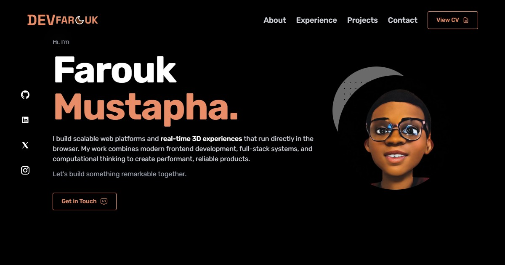

# Farouk Mustapha — Portfolio

Personal portfolio site, built with Next.js and TypeScript. Features a live topographic background rendered with Three.js / React Three Fiber that reacts to theme and pointer movement, alongside project, experience, and contact sections.

**Live:** [devfarouk.vercel.app](https://devfarouk.vercel.app)



## Tech Stack

- **Framework:** Next.js 14 (App Router), TypeScript
- **Styling:** Tailwind CSS, shadcn/ui, Radix UI
- **3D / Animation:** Three.js, React Three Fiber, @react-three/drei, @react-three/postprocessing, Framer Motion, AOS
- **Theming:** next-themes (dark/light)
- **Analytics:** Vercel Analytics, Google Analytics

## Features

- Animated 3D topographic background that shifts with theme and cursor position
- Dark and light mode
- Project showcase with live demo, GitHub, and optional Loom demo links
- Experience timeline and content driven from a single data file
- Open Graph and Twitter card metadata for link previews

## Getting Started

Clone the repo and install dependencies:

```bash
git clone https://github.com/Farouk-ayo/devfarouk.git
cd devfarouk
npm install
```

Run the dev server:

```bash
npm run dev
```

Open [http://localhost:3000](http://localhost:3000).

Build for production:

```bash
npm run build
npm start
```

## Project Structure

```
devfarouk/
├── app/
│   ├── components/    shared UI — navbar, sidebar, theme switch, 3D background
│   ├── sections/      page sections — header, about, experience, projects, contact
│   ├── projects/      full projects listing page
│   └── layout.tsx     root layout and metadata
├── components/ui/     shadcn/ui primitives
├── datas/
│   └── data.ts        content — technologies, experience, projects, social links
└── public/            images and icons
```

## Contact

- **Portfolio:** [devfarouk.vercel.app](https://devfarouk.vercel.app)
- **LinkedIn:** [linkedin.com/in/Faroukayo](https://linkedin.com/in/Faroukayo)
- **GitHub:** [github.com/Farouk-ayo](https://github.com/Farouk-ayo)
- **Email:** [mustaphafarouk41@gmail.com](mailto:mustaphafarouk41@gmail.com)
